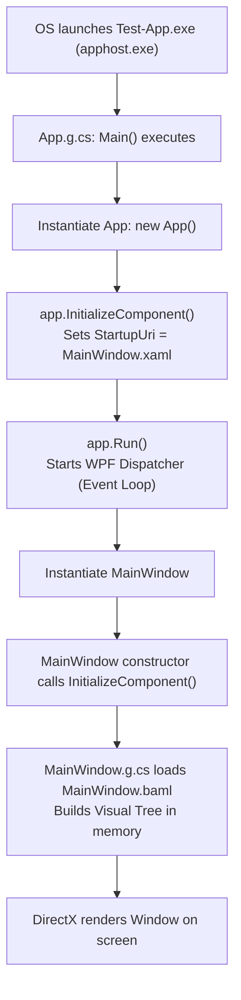

# WPF Architecture, Execution Flow & Boilerplate Explained

> **Guide for JS / React Native / MERN Developers**
> This document breaks down the default WPF (Windows Presentation Foundation) project structure, where the application begins execution, and what is happening behind the scenes (BTS).

---

## 1. High-Level Mental Model: WPF vs Modern Web / React Native

If you are coming from JavaScript, React, React Native, or Node.js, here is how the core WPF concepts map to tools you already know:

| WPF Concept | JS / React / React Native Equivalent | What it does |
| :--- | :--- | :--- |
| **`Test-App.csproj`** | `package.json` | Project configuration, target framework (.NET 9), dependencies, and build settings. |
| **`Test-App.sln`** | Workspace / Monorepo root | A solution file grouping one or more projects together. |
| **`App.xaml` + `App.xaml.cs`** | `index.js` / `App.jsx` + root providers | Global application configuration, startup window definition, and global resources/themes. |
| **`MainWindow.xaml`** | `Screen.jsx` / JSX template | Declarative UI markup (tags like `<Grid>`, `<Button>`, `<Window>`). |
| **`MainWindow.xaml.cs`** | Component code / logic | The "Code-Behind" class containing events, handlers, and lifecycle logic. |
| **`obj/` & `bin/`** | `dist/`, `build/`, `.next/` | Compiled output (`bin`) and intermediate generated build artifacts (`obj`). |
| **BAML (Binary XAML)** | Bundled bytecode (Hermes/Metro) | Pre-tokenized, compiled binary representation of your XAML for high performance. |
| **WPF Dispatcher** | JavaScript Event Loop | Single UI thread event queue that processes paint calls, layout updates, and input events. |

---

## 2. Where is `Main()`? The Main Entry Point Demystified

In standard C# (like a console app) or Node.js (`node server.js`), you expect a clear starting function: `static void Main(string[] args)`.

Looking at your files, **none** of them appear to have a `Main()` method. Why?

### The Markup Compiler (`PresentationBuildTasks`)
When you build the project, .NET runs a build tool called `PresentationBuildTasks`. It inspects `App.xaml` and automatically generates a hidden file in your intermediate directory:
📁 `obj/Debug/net9.0-windows/App.g.cs` (`.g.cs` stands for **generated C#**).

Here is the actual code generated inside `App.g.cs`:

```csharp
namespace Test_App {
    public partial class App : System.Windows.Application {
        
        public void InitializeComponent() {
            // Reads StartupUri from App.xaml
            this.StartupUri = new System.Uri("MainWindow.xaml", System.UriKind.Relative);
        }
        
        /// <summary>
        /// Application Entry Point.
        /// </summary>
        [System.STAThreadAttribute()] // Single-Threaded Apartment for Windows UI
        public static void Main() {
            Test_App.App app = new Test_App.App();
            app.InitializeComponent();
            app.Run(); // Starts the Dispatcher loop!
        }
    }
}
```

### What is `[STAThread]`?
Notice `[System.STAThreadAttribute()]`.
* **STA** stands for *Single-Threaded Apartment*.
* Windows desktop UI components (OLE, drag-and-drop, clipboard, system dialogs) require the UI thread to run in single-threaded mode.
* **JS Analogy:** Just like the browser and React Native have a dedicated main/UI thread that must not be blocked, WPF enforces a single UI thread via STA.

---

## 3. Step-by-Step Runtime Flow

Here is what happens when you hit **F5** or run `dotnet run`:



### Detailed Breakdown:
1. **OS Launch**: Windows starts the process using the native bootstrapper (`apphost.exe`), which bootstraps the .NET 9 CLR (Common Language Runtime).
2. **`Main()` Executes**: Calls `new Test_App.App()`.
3. **`InitializeComponent()`**: Configures the `StartupUri = "MainWindow.xaml"` that was specified in `App.xaml`.
4. **`app.Run()`**:
   - Initializes the **WPF Dispatcher** (the UI message pump / event loop).
   - Keeps the application alive until the last window closes or `Shutdown()` is invoked.
5. **Loading `MainWindow`**:
   - The framework instantiates `MainWindow`.
   - The constructor in `MainWindow.xaml.cs` runs `InitializeComponent()`.
   - `MainWindow.g.cs` calls `Application.LoadComponent(..., "mainwindow.xaml")`.
   - The pre-compiled binary markup (`MainWindow.baml`) is unpacked into C# objects (`Window`, `Grid`, etc.).
6. **Hardware-Accelerated Rendering**:
   - Unlike WinForms (which uses GDI+ software rendering), WPF renders all graphics using **DirectX** through the GPU pipeline.

---

## 4. Key Behind-The-Scenes (BTS) Concepts

### A. The "Partial Class" Magic
In `MainWindow.xaml.cs`, you see:
```csharp
public partial class MainWindow : Window
```
And in `obj/Debug/net9.0-windows/MainWindow.g.cs`, you see:
```csharp
public partial class MainWindow : System.Windows.Window, System.Windows.Markup.IComponentConnector
```

* **What it means:** The `partial` keyword allows a single C# class definition to be split across multiple files.
* **Why WPF uses it:** Your handwritten code stays clean in `MainWindow.xaml.cs`, while the compiler's generated code (like element name lookups and wire-ups) lives in `MainWindow.g.cs`. At build time, the C# compiler combines them into one unified class.
* **React Analogy:** Think of how JSX and JS logic sit in the same React component, but Babel transpiles the JSX part into `React.createElement` behind the scenes.

### B. XAML vs BAML
* **XAML** is human-readable XML markup.
* Parsing XML strings at runtime is slow and memory-intensive.
* WPF's build step compiles `.xaml` into **BAML** (*Binary Application Markup Language*).
* BAML is a binary stream of tokens that instantiates objects and assigns properties with near-native code speeds.

### C. XML Namespaces (`xmlns`)
In `MainWindow.xaml`:
```xml
<Window x:Class="Test_App.MainWindow"
        xmlns="http://schemas.microsoft.com/winfx/2006/xaml/presentation"
        xmlns:x="http://schemas.microsoft.com/winfx/2006/xaml"
        xmlns:d="http://schemas.microsoft.com/expression/blend/2008"
        xmlns:mc="http://schemas.openxmlformats.org/markup-compatibility/2006"
        xmlns:local="clr-namespace:Test_App">
```

* **Default `xmlns` (`presentation`)**: Equivalent to importing default React Native components (`View`, `Text`, `Button`, `Grid`).
* **`xmlns:x`**: The XAML language features namespace (e.g., `x:Class` specifies which C# class backs this XAML file; `x:Name` gives an element an ID).
* **`xmlns:local`**: Like `import * as local from './'`—allows you to use custom classes from your own project in XAML.
* **`xmlns:d` and `xmlns:mc`**: Designer hints (used by Visual Studio / Blend previewers at design time; ignored at runtime via `mc:Ignorable="d"`).

---

## 5. Summary Cheat Sheet

* **Entry point**: Generated `Main()` in `obj/.../App.g.cs` running on an `[STAThread]`.
* **Application host**: `App.xaml` / `App.xaml.cs` orchestrates lifecycle and specifies the first screen (`StartupUri`).
* **Main Screen**: `MainWindow.xaml` (declarative UI tree) + `MainWindow.xaml.cs` (logic & handlers).
* **UI Threading**: Single thread owned by the `Dispatcher`. All UI updates must happen on this thread (just like JS UI thread).
